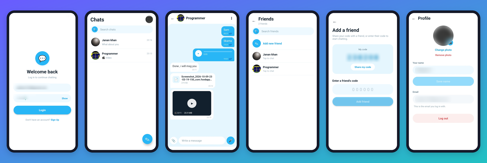
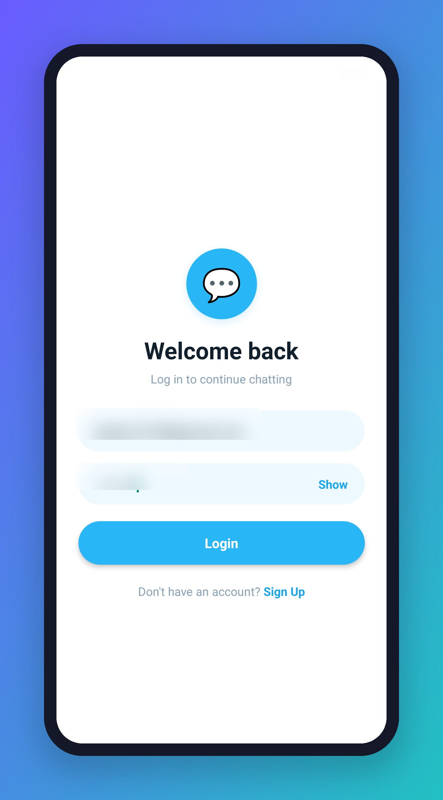
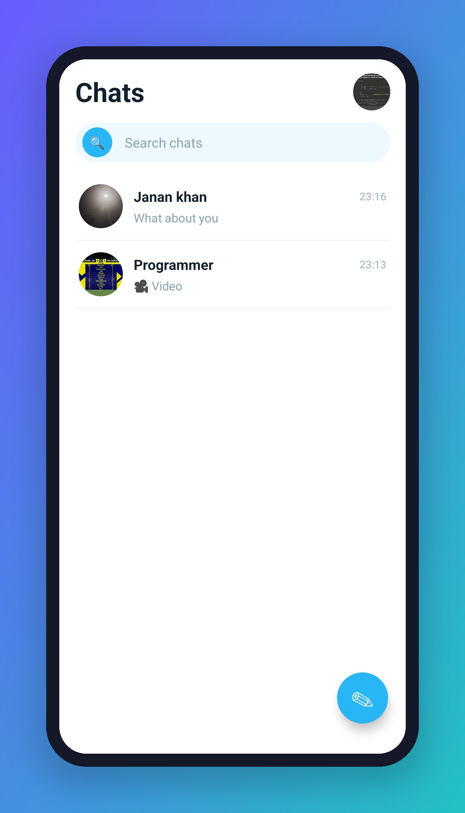
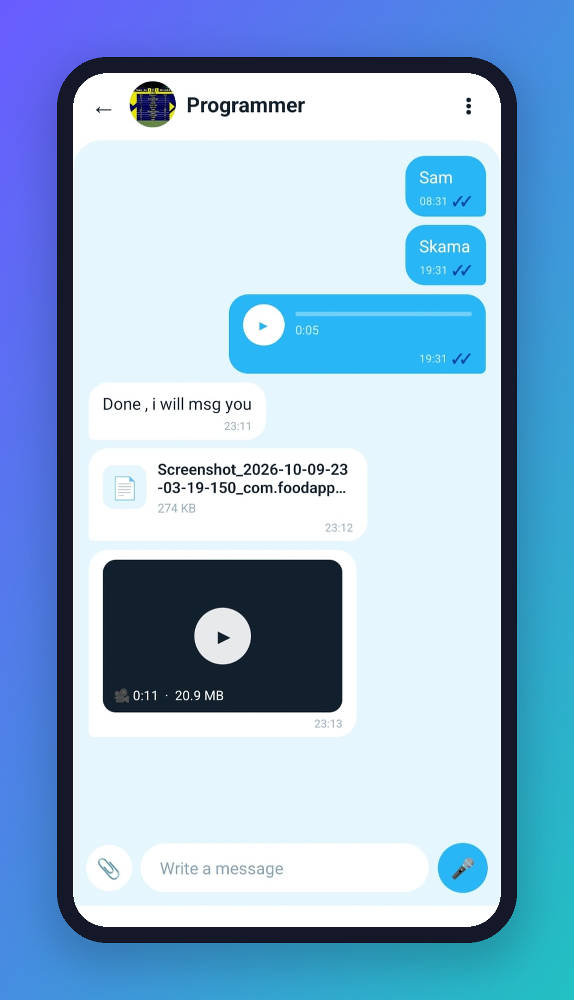
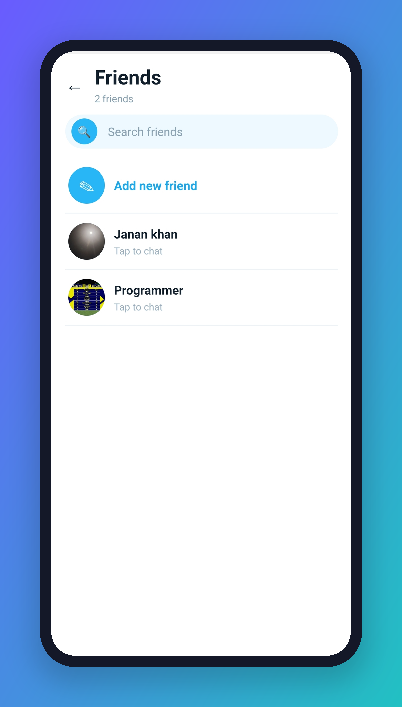
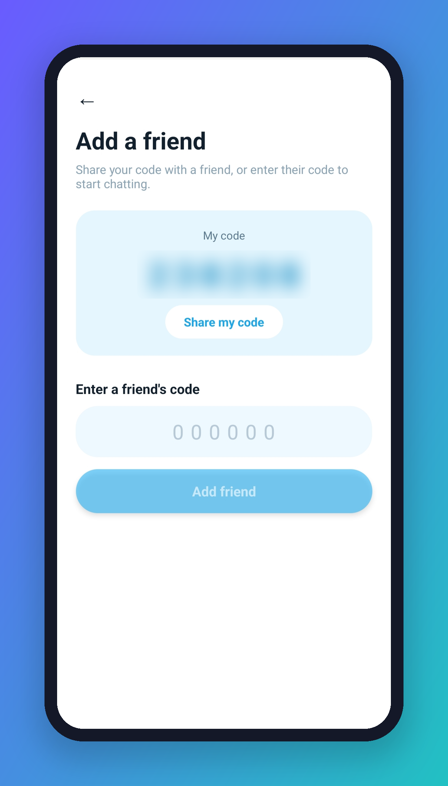
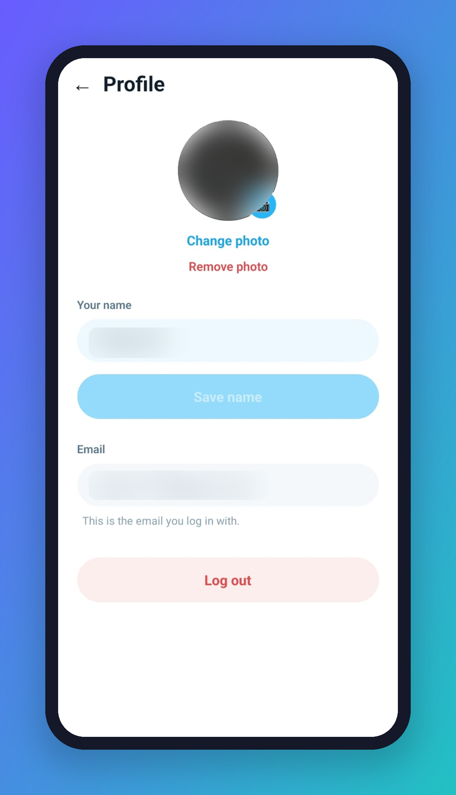

<div align="center">

# 💬 ChatApp

**A clean, modern real-world chat app built with React Native, TypeScript and Supabase.**




</div>

---

## ✨ Features

- 🔐 **Authentication** – sign up and log in with email and password (with show/hide password)
- 💬 **Chats list** – all conversations in one place with last message preview, time and search
- 📨 **Messaging** – text messages, voice messages, file attachments and videos, with sent/read ticks
- 👥 **Friends** – friends list with search and one-tap chat
- ➕ **Add friends by code** – every user gets a personal 6-digit code to share or enter
- 👤 **Profile** – change or remove your profile photo, edit your name, log out
- 🎨 **Polished UI** – rounded message bubbles, avatars and a consistent light-blue theme

## 📱 Screenshots

<table>
  <tr>
    <td align="center"><b>Login</b><br/></td>
    <td align="center"><b>Chats</b><br/></td>
    <td align="center"><b>Conversation</b><br/></td>
  </tr>
  <tr>
    <td align="center"><b>Friends</b><br/></td>
    <td align="center"><b>Add a friend</b><br/></td>
    <td align="center"><b>Profile</b><br/></td>
  </tr>
</table>

## 🛠️ Tech Stack

| Area | Technology |
| --- | --- |
| Framework | React Native (CLI, not Expo) |
| Language | TypeScript |
| Navigation | React Navigation (native stack) |
| Backend / Database | Supabase (Auth + Postgres) |
| State | React Context (`AuthContext`) |
| Platform | Android |

## 📂 Project Structure

```
ChatApp/
├── App.tsx              # Navigation setup
├── AuthContext.tsx      # Auth state (login, signup, logout)
├── AuthScreen.tsx       # Login / Sign up
├── HomeScreen.tsx       # Chats list
├── ChatScreen.tsx       # Conversation screen
├── FriendsScreen.tsx    # Friends list
├── AddFriendScreen.tsx  # Share / enter friend code
├── ProfileScreen.tsx    # Edit profile
├── Avatar.tsx           # Reusable avatar component
├── supabase.ts          # Supabase client
└── android/             # Android native project
```

## 🚀 Getting Started

### Prerequisites

- Node.js and npm
- Android Studio with an emulator or a physical Android device
- JDK and the Android SDK set up for React Native CLI
- A free [Supabase](https://supabase.com) project

### Installation

1. Clone the repository
   ```bash
   git clone https://github.com/samadafrid1018/ChatApp.git
   cd ChatApp
   ```
2. Install dependencies
   ```bash
   npm install
   ```
3. Open `supabase.ts` and add your own Supabase **Project URL** and **publishable key**.
4. Make sure Row Level Security (RLS) is enabled on your tables and the policies are set up (see [Database](#-database)).
5. Start Metro
   ```bash
   npx react-native start
   ```
6. In a second terminal, run the app on Android
   ```bash
   npx react-native run-android
   ```

## 🗄️ Database

The app uses Supabase Postgres with **Row Level Security** so users can only read their own conversations and friendships. The full table definitions and policies are in [`supabase/schema.sql`](supabase/schema.sql).

## 📦 Build a Release APK

```bash
cd android
.\gradlew clean
.\gradlew assembleRelease
```

The APK is generated at:

```
android/app/build/outputs/apk/release/app-release.apk
```

> 🔒 Never commit your keystore or its passwords. They are already excluded in `.gitignore`.

## 🗺️ Roadmap

- [ ] Push notifications
- [ ] Group chats
- [ ] Dark mode
- [ ] iOS support

## 👨‍💻 Author

**Abdul Samad** – React Native developer

- GitHub: [@samadafrid1018](https://github.com/samadafrid1018)

---

<div align="center">

If you like this project, please give it a ⭐

</div>
